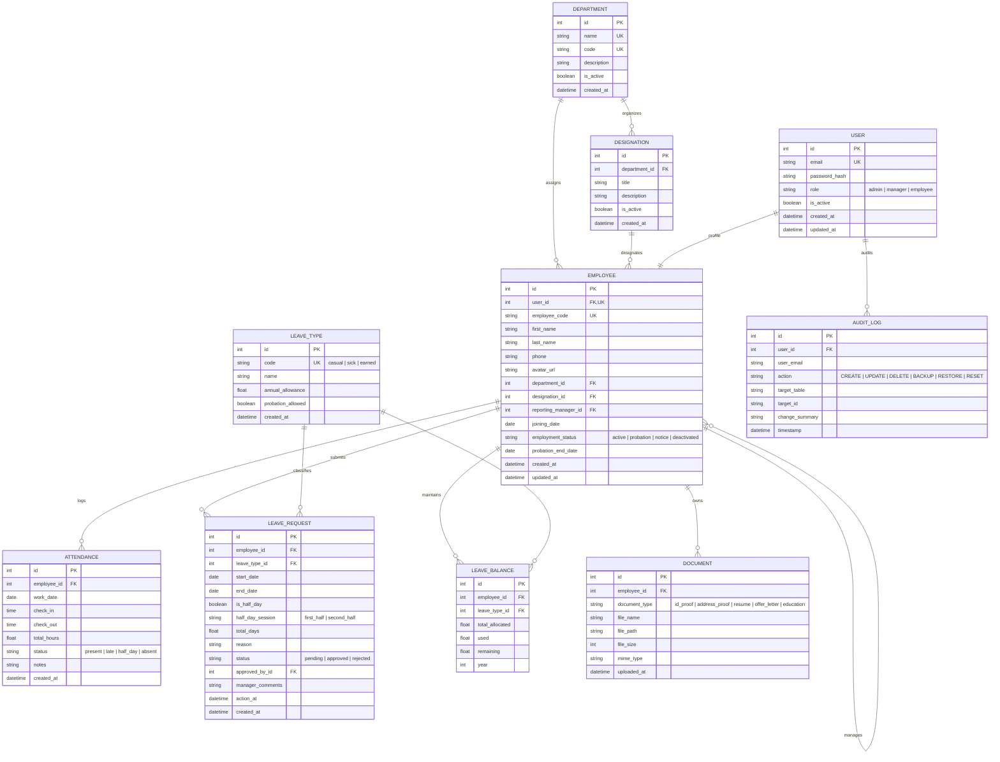

# Enterprise Employee Management & HR Portal

A production-quality web application built with FastAPI, SQLAlchemy ORM, Alembic migrations, SQLite, and React (Vite). Designed with a strictly bespoke white, near-black (`#0A0A0A`), and neutral grey design system with custom line icons and zero generic UI kits.

---

## Architecture & Technology Stack

- **Backend**: Python 3.11+, FastAPI, SQLAlchemy ORM 2.x, Alembic, Pydantic V2
- **Database**: SQLite (`/data/hrportal.db` with PRAGMA foreign keys enabled)
- **Frontend**: React 19 (Vite) with bespoke CSS design tokens, Lucide line icons, Inter typography
- **Authentication**: JWT tokens transmitted via `httpOnly` cookies with bcrypt password hashing (12 rounds)
- **Automated Tests**: pytest suite with 23 test cases covering authentication, RBAC authorization, leave policies, and administrative operations

---

## Role-Based Access Control (RBAC)

The application enforces access controls strictly at the backend API layer across three core personas:

1. **Admin / HR**:
   - Complete directory oversight: create, edit, and deactivate employees
   - Department and designation CRUD
   - Full Data Manager access: database table browser, inline CRUD, CSV/JSON import & export, automated snapshots, one-click restore, and audit log inspection
2. **Manager**:
   - Access to direct reports' profiles
   - Team attendance log and daily presence review
   - Leave approval queue: review pending leave requests with approval/rejection comments and automatic balance deductions
3. **Employee**:
   - Personal profile and contact information updates
   - Daily attendance check-in and check-out with automatic late and half-day calculations
   - Monthly attendance calendar view with attendance status indicators
   - Leave applications (including single-day half-day sessions) and remaining annual balances

---

## Quick Start (Two Commands + Seed Script)

### 1. Prerequisites
- Python 3.11+
- Node.js 18+ & npm

### 2. Backend Setup & Startup
Install dependencies and run the server:
```bash
# Install backend packages
pip install -r backend/requirements.txt

# Run migrations & seed realistic sample data (24 employees, 4 departments, 3 months attendance)
python seed.py

# Start FastAPI backend (runs on http://127.0.0.1:8000)
uvicorn backend.app.main:app --host 127.0.0.1 --port 8000 --reload
```

### 3. Frontend Setup & Startup
In a separate terminal, install dependencies and start the Vite development server:
```bash
cd frontend
npm install
npm run dev
```
Open **`http://localhost:5173`** in your browser. All API requests are automatically reverse-proxied to the backend at port 8000.

---

## Demo Accounts & Test Credentials

The database comes pre-seeded with 24 realistic Indian enterprise accounts:

| Role | Name & Title | Email Address | Password | Key Permissions & Features |
| :--- | :--- | :--- | :--- | :--- |
| **Admin / HR** | Aarav Sharma (HR Director) | `admin@company.com` | `Admin@1234` | Full portal access, Data Manager, Org setup, Audit logs |
| **Manager** | Rajesh Kumar (Eng. Manager) | `rajesh.kumar@company.com` | `Manager@1234` | Manages 7 direct reports, team attendance, leave approval queue |
| **Manager** | Priya Sharma (Product Lead) | `priya.sharma@company.com` | `Manager@1234` | Manages Product & Design team approvals |
| **Manager** | Amit Patel (Operations Director) | `amit.patel@company.com` | `Manager@1234` | Manages Finance & Operations team |
| **Employee** | Vikram Aditya (Sr. Software Eng.) | `vikram.aditya@company.com` | `Employee@1234` | Check-in/out, leave apply, balance summary, docs |
| **Employee (Probation)** | Rohit Verma (Software Eng.) | `rohit.verma@company.com` | `Employee@1234` | Demonstrates probation leave policy restrictions |

> **Convenience Feature**: The portal includes an instant role switcher in the top navigation bar so you can switch between Admin, Manager, and Employee personas with a single click.

---

## Entity Relationship Diagram (ERD)



---

## Core Features & Business Logic

### 1. Leave Management & Probation Rules
- **Leave Types**: Casual Leave (12 days), Sick Leave (10 days), Earned Leave (18 days).
- **Probation Policy**: Employees on probation (`employment_status == "probation"` or joining date within active probation period) are restricted from applying for Earned Leave. Attempting to apply returns an HTTP 400 error.
- **Negative Balance & Overlap Prevention**: The backend verifies available balances and date overlap before allowing a submission.
- **Half-Day Option**: Applies for exactly 0.5 days on a single calendar day with choice of morning (`first_half`) or afternoon (`second_half`) session.
- **Automatic Balance Deduction**: When a manager approves a request, the balance is deducted atomically in the database.

### 2. Attendance Tracking Engine
- **Check-In**: Records timestamp. If after **09:30 AM**, automatically categorized as `late`.
- **Check-Out**: Computes exact duration. If total duration is less than **4.5 hours**, marked as `half_day`.
- **Monthly Calendar**: Displays past records, holidays, weekends, approved leave days, and absences.

### 3. Data Manager (Admin Only)
- **Table Browser**: Live reflection of all 10 SQLite database tables (`users`, `employees`, `departments`, `designations`, `attendances`, `leave_types`, `leave_balances`, `leave_requests`, `documents`, `audit_logs`).
- **Dynamic CRUD**: Add, edit, or delete rows directly from the UI with server-side validation.
- **CSV & JSON Import/Export**: One-click per-table export and batch upload.
- **One-Click Backup & Restore**: Download `.db` file snapshots and validate uploaded SQLite binaries before applying.
- **Audit Logging**: Every action across the system is recorded with timestamp, actor, target table, and summary.

---

## API Documentation

FastAPI provides interactive OpenAPI documentation at:
- **Swagger UI**: [http://127.0.0.1:8000/docs](http://127.0.0.1:8000/docs)
- **ReDoc**: [http://127.0.0.1:8000/redoc](http://127.0.0.1:8000/redoc)

### Key Endpoints Summary:
- `POST /api/auth/login`: Authenticates user and sets `httpOnly` JWT cookie.
- `POST /api/auth/logout`: Clears session cookie.
- `GET /api/auth/me`: Returns active user profile.
- `GET /api/dashboard/stats`: Role-filtered headcount, attendance, and department stats.
- `GET /api/employees`: Directory list with search, department, and status filters.
- `POST /api/employees`: Admin employee creation with automatic leave balance initialization.
- `POST /api/employees/{id}/documents`: Document upload with MIME type and size checks.
- `POST /api/attendance/check-in`: Daily attendance check-in.
- `POST /api/attendance/check-out`: Daily check-out and work hours calculation.
- `GET /api/attendance/monthly`: Calendar view data for specified month.
- `POST /api/leaves/apply`: Submits leave request with probation, balance, and overlap checks.
- `POST /api/leaves/{id}/action`: Manager approval or rejection with comments and automatic deduction.
- `GET /api/data-manager/tables`: Introspects metadata and row counts for all database tables.
- `POST /api/data-manager/query`: Paginated query with search and sort.
- `GET /api/data-manager/backup`: Streams SQLite `.db` file for local backup.
- `POST /api/data-manager/restore`: Validates and restores database from an uploaded backup file.
- `POST /api/data-manager/reset`: Resets database to sample seed data.

---

## Automated Test Suite

Run the full pytest suite covering authentication, RBAC authorization, business rules, and data manager:
```bash
pytest -v
```
All 23 test cases run in under 8 seconds.

